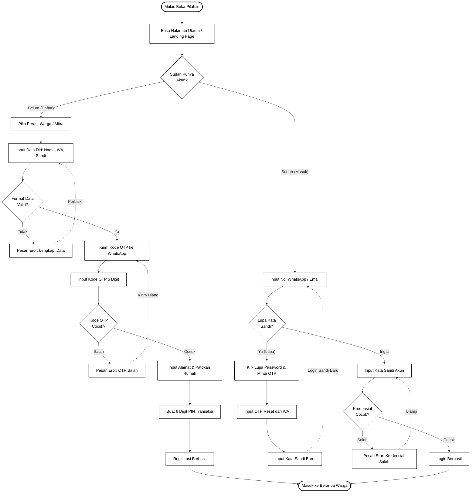
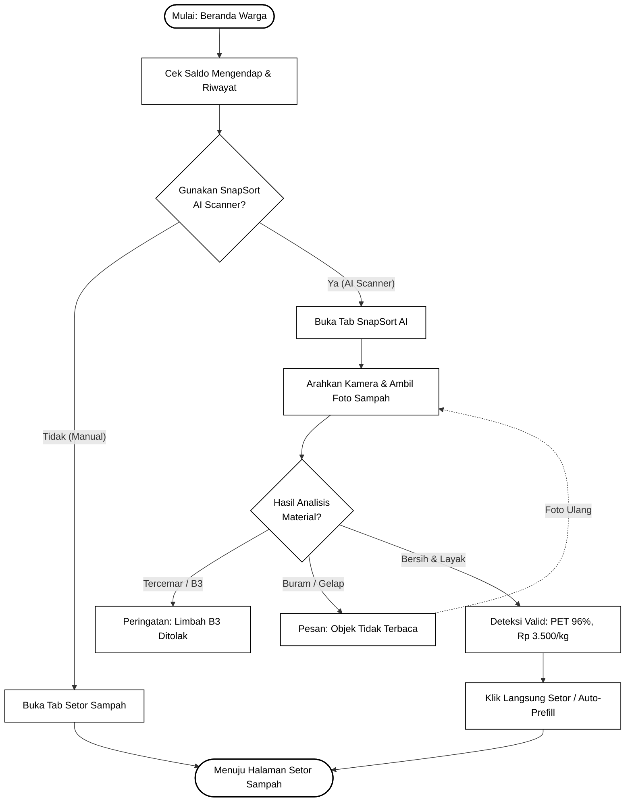
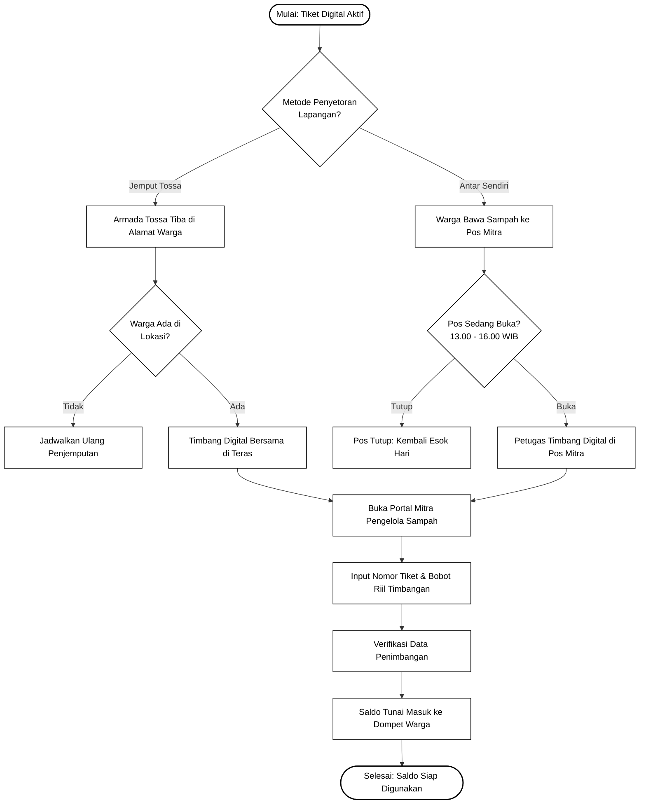

# Userflow Pilah.in per Fase (Clean Monochrome)

Dokumen ini menyajikan **Userflow Pilah.in per Fase** dengan format **Monochrome (Hitam & Putih / Tanpa Warna)** agar sangat mudah di-screenshot per fasenya. 

### Karakteristik Desain:
- ⚪ **Clean Monochrome:** Seluruh diagram menggunakan warna dasar putih, garis batas hitam, dan teks hitam bersih (*zero color clutter*).
- 📦 **1 Kotak = 1 Proses Granular:** Setiap kotak persegi panjang hanya merepresentasikan satu tindakan nyata pengguna atau sistem.
- 🚫 **Tanpa "Fast Demo":** Alur login murni melalui proses autentikasi standar (Input WhatsApp/Email $\rightarrow$ Sandi / Penanganan Lupa Sandi).
- 🔄 **Alur Alternatif / Validasi Netral:** Tidak menggunakan label atau istilah berlebihan seperti "Sad Path"; menggunakan penamaan standar *flowchart* (misal: *Format Data Valid?*, *Pesan Eror Validasi*, *Kode OTP Cocok?*, *Kirim Ulang OTP*, *Lupa Kata Sandi?*).
- 📸 **Sangat Mudah Di-Screenshot:** Setiap fase dipisahkan ke dalam kanvas berukuran proporsional yang pas di layar.

---

> [!TIP]
> ### 3 Cara Melihat & Mengambil Screenshot per Fase:
> 1. **Web Viewer Interaktif (Rekomendasi untuk Screenshot):**  
>    Buka **[http://localhost:3000/userflow_view.html](http://localhost:3000/userflow_view.html)** di browser. Anda dapat berpindah tab per fase dan langsung screenshot atau klik tombol **"Unduh Gambar PNG"**.
> 2. **File Draw.io Multi-Tab:**  
>    Buka **[userflow_pilahin.drawio](file:///home/jansky/pilahin-app/userflow_pilahin.drawio)** di [app.diagrams.net](https://app.diagrams.net/). Di bagian bawah terdapat 5 tab/sheet yang masing-masing berisi 1 fase.
> 3. **File Draw.io Individual per Fase:**  
>    Tersedia di folder **[drawio_phases/](file:///home/jansky/pilahin-app/drawio_phases/)**:
>    - [fase_1_registrasi_dan_login.drawio](file:///home/jansky/pilahin-app/drawio_phases/fase_1_registrasi_dan_login.drawio)
>    - [fase_2_beranda_dan_snapsort_ai.drawio](file:///home/jansky/pilahin-app/drawio_phases/fase_2_beranda_dan_snapsort_ai.drawio)
>    - [fase_3_pengajuan_setor_sampah.drawio](file:///home/jansky/pilahin-app/drawio_phases/fase_3_pengajuan_setor_sampah.drawio)
>    - [fase_4_timbang_lapangan_dan_mitra.drawio](file:///home/jansky/pilahin-app/drawio_phases/fase_4_timbang_lapangan_dan_mitra.drawio)
>    - [fase_5_belanja_toko_dan_tarik_tunai.drawio](file:///home/jansky/pilahin-app/drawio_phases/fase_5_belanja_toko_dan_tarik_tunai.drawio)

---

## Rincian & Diagram Mermaid per Fase

### Fase 1: Registrasi, Verifikasi OTP & Login (Tanpa Fast Demo)
- **Tujuan:** Pendaftaran akun baru secara bertahap (Data $\rightarrow$ OTP $\rightarrow$ Alamat $\rightarrow$ PIN) dan masuk akun terdaftar dengan penanganan lupa kata sandi.



---

### Fase 2: Beranda Warga & Deteksi Sampah (SnapSort AI)
- **Tujuan:** Memantau saldo mengendap dan memindai sampah menggunakan model AI atau langsung memilih kategori sampah manual.



---

### Fase 3: Pengajuan Penyetoran Sampah (Jemput Tossa vs Drop-off Mandiri)
- **Tujuan:** Menentukan kategori & berat sampah, memilih metode penyetoran, dan menerbitkan tiket QR digital.

```mermaid
flowchart TD
    classDef default fill:#ffffff,stroke:#000000,stroke-width:1.2px,color:#000000
    classDef startEnd fill:#ffffff,stroke:#000000,stroke-width:2px,color:#000000
    classDef decision fill:#ffffff,stroke:#000000,stroke-width:1.2px,color:#000000

    Start([Mulai: Tab Setor Sampah]):::startEnd --> PickWaste[Pilih Kategori & Atur Berat kg]
    PickWaste --> DecWasteValid{Kategori Terpilih &<br/>Berat > 0 kg?}:::decision

    DecWasteValid -- "Tidak" --> ErrEmpty[Pesan: Pilih Minimal 1 Jenis Sampah]
    ErrEmpty -.->|Pilih Sampah| PickWaste

    DecWasteValid -- "Ya" --> DecMethod{Pilih Metode<br/>Penyetoran?}:::decision

    %% Jemput Tossa
    DecMethod -- "Jemput Armada Tossa" --> CalcTossa[Kalkulasi Ongkir Jemput 10%]
    CalcTossa --> PickAddr[Pilih Alamat Jemput & Cek Patokan]
    PickAddr --> DecAddrValid{Alamat & Patokan<br/>Lengkap?}:::decision
    
    DecAddrValid -- "Kurang / Ubah" --> EditAddr[Input / Perbarui Alamat & Patokan]
    EditAddr -.->|Simpan| PickAddr
    
    DecAddrValid -- "Lengkap" --> SubmitTossa[Klik Ajukan Penjemputan Tossa]

    %% Drop-off
    DecMethod -- "Antar Sendiri (Drop-off)" --> CalcDropoff[Kalkulasi Ongkir Rp 0 (100% Saldo)]
    CalcDropoff --> PickPos[Pilih Pos / Drop Point Mitra Terdekat]
    PickPos --> SubmitDropoff[Klik Buat Tiket Mandiri]

    SubmitTossa --> TicketQR[Tiket Digital QR Terbit: PLH-XXXXXX]
    SubmitDropoff --> TicketQR

    TicketQR --> EndSetor([Selesai: Menunggu Penimbangan Lapangan]):::startEnd
```

---

### Fase 4: Operasional Timbang Lapangan & Verifikasi Mitra
- **Tujuan:** Proses penimbangan digital di teras atau pos mitra dan penginputan data tiket oleh petugas mitra di Portal Mitra Pengelola.



---

### Fase 5: Pemanfaatan Saldo Likuid Warga
- **Tujuan:** Warga menggunakan saldo mengendap untuk berbelanja produk daur ulang (pupuk kompos) atau mencairkannya ke dompet digital (GoPay/DANA).

```mermaid
flowchart TD
    classDef default fill:#ffffff,stroke:#000000,stroke-width:1.2px,color:#000000
    classDef startEnd fill:#ffffff,stroke:#000000,stroke-width:2px,color:#000000
    classDef decision fill:#ffffff,stroke:#000000,stroke-width:1.2px,color:#000000

    Start([Mulai: Saldo Mengendap di Dompet]):::startEnd --> DecUse{Pilihan Pemanfaatan<br/>Saldo?}:::decision

    %% Belanja
    DecUse -- "Belanja Produk Upcycle" --> OpenStore[Buka Tab Toko Sirkular]
    OpenStore --> PickProduct[Pilih Pupuk Kompos Super 5kg: Rp 18.000]
    PickProduct --> DecBalStore{Saldo Cukup<br/>>= Rp 18.000?}:::decision
    
    DecBalStore -- "Tidak" --> ErrBalStore[Pesan: Saldo Tidak Mencukupi]
    DecBalStore -- "Cukup" --> PINStore[Input PIN Transaksi 6 Digit]
    PINStore --> StoreDone[Pembelian Kompos Selesai / Loop Tertutup]

    %% Tarik Tunai
    DecUse -- "Tarik Tunai E-Wallet" --> OpenWallet[Buka Tab Dompet Rupiah]
    OpenWallet --> InpCashout[Pilih GoPay/DANA, Nominal Rp 50.000, & No HP]
    InpCashout --> DecMin{Nominal >= 10k &<br/>No HP Valid?}:::decision
    
    DecMin -- "Tidak" --> ErrMin[Pesan: Minimal Penarikan Rp 10.000]
    ErrMin -.->|Perbaiki| InpCashout
    
    DecMin -- "Valid" --> DecBalCash{Saldo Cukup<br/>>= Rp 50.000?}:::decision
    
    DecBalCash -- "Kurang" --> ErrBalCash[Pesan: Saldo Mengendap Kurang]
    DecBalCash -- "Cukup" --> PINCash[Input PIN Transaksi 6 Digit]
    PINCash --> CashDone[Uang Tunai Cair ke E-Wallet (0% Admin Fee)]

    StoreDone --> EndUse([Selesai: Nilai Ekonomi & Lingkungan Nyata]):::startEnd
    CashDone --> EndUse
```

---

## Ringkasan File Siap Pakai

| Item | Tipe | Lokasi File |
|---|---|---|
| **Web Viewer Interaktif** | Live Browser | [http://localhost:3000/userflow_view.html](http://localhost:3000/userflow_view.html) |
| **Draw.io Master (5 Tabs)** | Diagram | [userflow_pilahin.drawio](file:///home/jansky/pilahin-app/userflow_pilahin.drawio) |
| **Draw.io Information Architecture** | Diagram | [information_architecture_pilahin.drawio](file:///home/jansky/pilahin-app/information_architecture_pilahin.drawio) |
| **PNG Screenshot IA (Proposal)** | Gambar | [information_architecture_pilahin.png](file:///home/jansky/Screenshots_Userflow/information_architecture_pilahin.png) |
| **Draw.io Fase 1** | Diagram | [fase_1_registrasi_dan_login.drawio](file:///home/jansky/pilahin-app/drawio_phases/fase_1_registrasi_dan_login.drawio) |
| **Draw.io Fase 2** | Diagram | [fase_2_beranda_dan_snapsort_ai.drawio](file:///home/jansky/pilahin-app/drawio_phases/fase_2_beranda_dan_snapsort_ai.drawio) |
| **Draw.io Fase 3** | Diagram | [fase_3_pengajuan_setor_sampah.drawio](file:///home/jansky/pilahin-app/drawio_phases/fase_3_pengajuan_setor_sampah.drawio) |
| **Draw.io Fase 4** | Diagram | [fase_4_timbang_lapangan_dan_mitra.drawio](file:///home/jansky/pilahin-app/drawio_phases/fase_4_timbang_lapangan_dan_mitra.drawio) |
| **Draw.io Fase 5** | Diagram | [fase_5_belanja_toko_dan_tarik_tunai.drawio](file:///home/jansky/pilahin-app/drawio_phases/fase_5_belanja_toko_dan_tarik_tunai.drawio) |
| **PNG Screenshot Fase 1** | Gambar | [fase_1_registrasi_dan_login.png](file:///home/jansky/pilahin-app/flow_screenshots/fase_1_registrasi_dan_login.png) |
| **PNG Screenshot Fase 2** | Gambar | [fase_2_beranda_dan_snapsort_ai.png](file:///home/jansky/pilahin-app/flow_screenshots/fase_2_beranda_dan_snapsort_ai.png) |
| **PNG Screenshot Fase 3** | Gambar | [fase_3_pengajuan_setor_sampah.png](file:///home/jansky/pilahin-app/flow_screenshots/fase_3_pengajuan_setor_sampah.png) |
| **PNG Screenshot Fase 4** | Gambar | [fase_4_timbang_lapangan_dan_mitra.png](file:///home/jansky/pilahin-app/flow_screenshots/fase_4_timbang_lapangan_dan_mitra.png) |
| **PNG Screenshot Fase 5** | Gambar | [fase_5_belanja_toko_dan_tarik_tunai.png](file:///home/jansky/pilahin-app/flow_screenshots/fase_5_belanja_toko_dan_tarik_tunai.png) |
